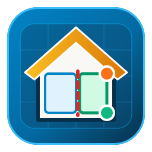
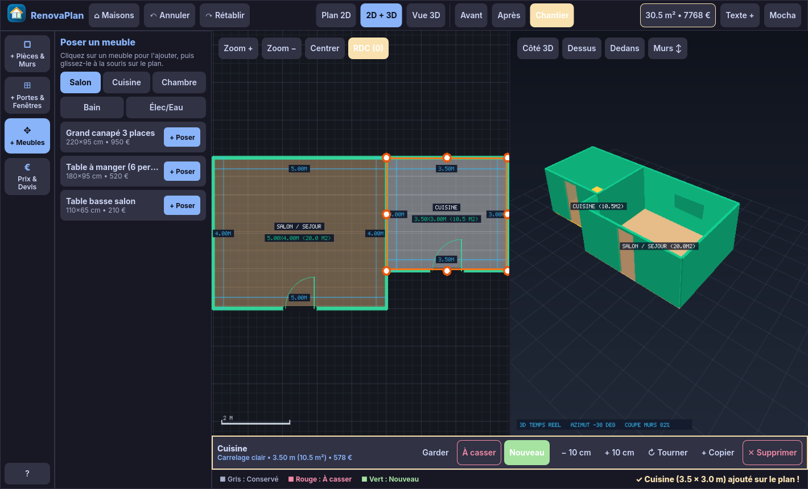
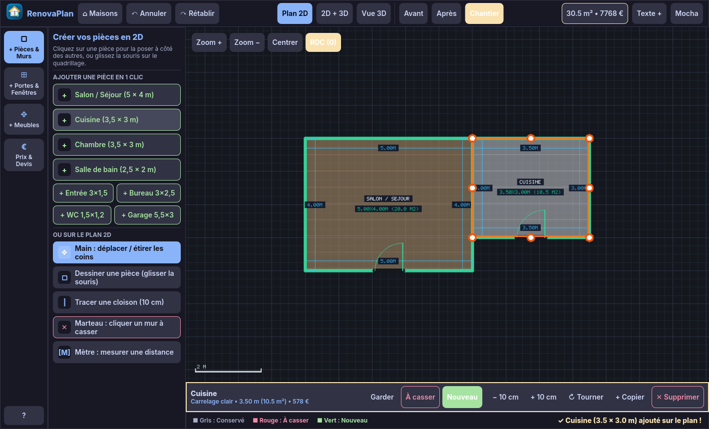
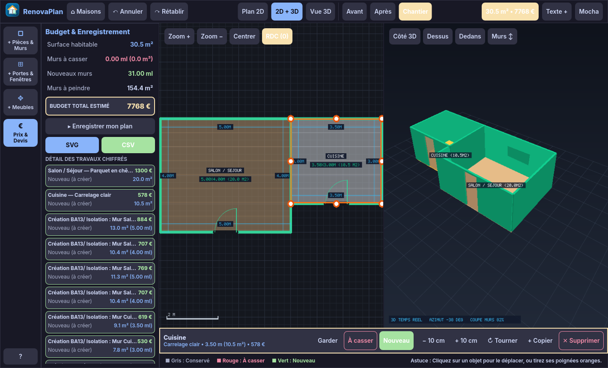

<p align="center">
  
</p>
<h1 align="center">RenovaPlan</h1>

<p align="center">A native floor-plan and 3D home renovation planner for Linux.<br>Written in Rust, built with Slint, optimized for Wayland (Pop!_OS) and packaged as an offline Flatpak.</p>

<p align="center">
  <a href="LICENSE"></a>
  
  
  
</p>



## What you can do

- **1-Click Ready Rooms**: Drop full pre-dimensioned rooms in a single click (Living Room $5 \times 4\,\text{m}$, Kitchen $3.5 \times 3\,\text{m}$, Bedroom $3.5 \times 3\,\text{m}$, Bathroom $2.5 \times 2\,\text{m}$, Hallway, Office, WC, Garage). Each room is created with perimeter walls, entrance door, and flooring material, automatically placed without overlapping.
- **Renovation Phasing**: Tag any wall, door or furniture as **Existing** (slate blue), **Demolition** (dashed red), or **New** (emerald green). Switch instantly between **Worksite (All)**, **Before (Existing state)**, and **After (Final planned result)** views.
- **Real-Time 2D + 3D Synchronized View**: Work in 2D floor-plan mode, 3D perspective, or side-by-side split view. The 3D viewport features wall cutaway height adjustments, orbit controls, preset angles (Isometric, Top-down, Southern facade, Interior walkthrough), and directional solar lighting with ground shadows.
- **Loi Carrez Surfaces & Cotations**: Automatic architectural dimension lines ($m$), room labels, and live surface calculations separating habitable area ($h \ge 1.80\,\text{m}$) from gross floor area.
- **Smart Openings**: Place single doors with swing clearance arcs, double doors, pocket/sliding doors, open passages, single/double windows, and large bay windows that automatically cut into target walls.
- **Interactive Editing**: Drag rooms or resize them in real time with 8 corner/midpoint orange handles. Perimeter walls stretch and move automatically with their room.
- **Automated Bill of Quantities (BoQ) & Budget**: Real-time breakdown of walls to demolish ($m^3$ rubble estimation), new drywall partitions (linear meters), net paintable wall surface ($m^2$ minus openings), doors/windows count, and estimated materials & labor cost.
- **Exports**: Save and restore standalone `.json` projects, export vector `.svg` technical plans, and generate `.csv` cost estimates.
- **Design & Themes**: Includes **Architect Blueprint (Light Paper)**, **Pop!_OS COSMIC Dark**, **Catppuccin Mocha**, and **Nord Architect**, along with a **Large Text** toggle for enhanced accessibility.

<details>
<summary>View 2D Floor Plan & Estimate screenshots</summary>

### 2D Floor Plan with 1-Click Rooms and Dimension Lines


### Bill of Quantities & Renovation Estimate Drawer


</details>

## Install

### Flatpak (Recommended)

RenovaPlan is designed to run in an offline, sandboxed Flatpak container on Linux:

```sh
# Build and install the Flatpak bundle locally
./scripts/build-flatpak.sh
flatpak run io.github.tonyboysuper.RenovaPlan
```

## Build from source

RenovaPlan requires a current stable Rust toolchain (Rust **1.92 or newer**), Cargo, and platform windowing libraries:

```sh
git clone https://github.com/Lib-LOCALE/renova-plan.git
cd renova-plan

# Debian / Ubuntu / Pop!_OS build dependencies
sudo apt install build-essential pkg-config libfontconfig1-dev libxkbcommon-dev

# Run with native Wayland/X11 acceleration
cargo run --locked
```

For software rendering (e.g. running in headless CI or VM without OpenGL):

```sh
SLINT_BACKEND=winit-software cargo run --locked
```

To compile an optimized binary:

```sh
cargo build --release --locked
./target/release/renova-plan
```

## Everyday shortcuts

| Action | Shortcut | Action | Shortcut |
| --- | --- | --- | --- |
| Select tool | `V` or `Esc` | Tape measure | `M` |
| Draw load-bearing wall | `W` | Rotate selected object | `T` |
| Draw partition (10 cm) | `P` | Undo | `Ctrl+Z` |
| Draw custom room | `R` | Redo | `Ctrl+Y` |
| Place door on wall | `D` | Delete selected object | `Delete` / `Backspace` |
| Place window on wall | `F` | Zoom in / Zoom out | Mouse wheel / `+` `-` |

## Architecture

The project is structured as a modular Cargo workspace:

```
renova-plan/
├── moteur/             # Pure computational geometry and rendering engine (zero UI dependency)
│   ├── src/canvas.rs   # Software pixel buffer with anti-aliased lines, rects, arcs and fonts
│   ├── src/model.rs    # Renovation domain models (Walls, Openings, Rooms, Furniture, RenoStatus)
│   ├── src/project.rs  # Project data structures, auto-placement algorithms, Loi Carrez & BoQ metrics
│   ├── src/render2d.rs # Architectural 2D blueprint renderer (cotations, hatches, handles, snap)
│   └── src/render3d.rs # Real-time software 3D wireframe & shaded polygon renderer with sun shadows
├── ui/                 # Slint declarative user interface
│   ├── renova.slint    # Responsive 4-step wizard, 2D/3D viewports, catalog drawer, and property bar
│   ├── data/i18n.json  # French and English translation strings
│   └── fonts/          # Embedded Inter Variable font (SIL OFL)
├── src/                # Application bootstrap & native window integration
│   ├── main.rs         # Event loop, undo/redo stack, camera navigation, winit keybindings
│   ├── native.rs       # Platform theme palettes, user preferences persistence
│   └── smoke.rs        # Automated headless UI integration tests & scenario capture
├── flatpak/            # Flatpak manifest, desktop launcher, and AppStream metadata
├── icons/              # VectorCraft SVG original artwork, animated SVG, and PNG assets
└── scripts/            # Flatpak offline vendoring and build automation
```

## Development & Quality checks

```sh
# Run all unit and integration tests across the workspace
cargo test --locked --workspace

# Strict Clippy check with zero warnings allowed
cargo clippy --locked --workspace --all-targets -- -D warnings
```

## Credits and licences

- **Application code:** Under the [MIT license](LICENSE).
- **Branding & vector icon:** Original VectorCraft vector artwork, MIT ([icons/icon.svg](icons/icon.svg)).
- **Slint toolkit:** Used under the [Royalty-free Desktop, Mobile, and Web Applications License 2.0](https://github.com/slint-ui/slint/blob/master/LICENSES/LicenseRef-Slint-Royalty-free-2.0.md). The application includes `AboutSlint` in its Help dialog.
- **Typography:** [Inter Variable](https://github.com/rsms/inter), SIL Open Font License 1.1 (included in [ui/fonts/OFL.txt](ui/fonts/OFL.txt)).

<p align="center">
  <a href="https://slint.dev">
    <picture>
      <source media="(prefers-color-scheme: dark)" srcset="https://raw.githubusercontent.com/slint-ui/slint/v1.18.1/internal/compiler/widgets/common/MadeWithSlint-logo-dark.svg">
      
    </picture>
  </a>
</p>
