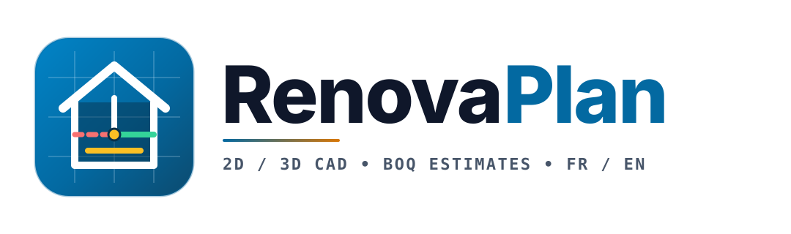

<p align="center">
  <picture>
    <source media="(prefers-color-scheme: dark)" srcset="assets/branding/wordmark.svg">
    
  </picture>
</p>

<p align="center">
  <b>Floor plans, a 3D model and a works budget for your renovation — offline, on your desktop.</b>
</p>

<p align="center">
  <a href="https://github.com/Lib-LOCALE/renova-plan/actions/workflows/ci.yml"></a>
  <a href="LICENSE"></a>
  
  
  
</p>

---

RenovaPlan turns a survey of your home into a dimensioned plan, a 3D model you can walk through and a priced list of works. Every wall, door and room carries a site status — **existing**, **to demolish** or **to build** — so you can show the house before, during and after the works.

It is a native desktop app: no account, no subscription, no telemetry. Your projects are plain files on your disk.

## Features

**Build by dragging**
- Drag a room, a wall, a door, a window or a piece of furniture from the catalogue into the plan or straight into the 3D view.
- Rooms snap to neighbouring walls and furniture backs onto the nearest wall.
- Quick actions float next to the selected object: rotate, copy, change the floor, delete.

**Plan and 3D, one model**
- Dimensioned 2D plan, 3D model, or both side by side — they edit the same data.
- Several levels, exploded view, exterior, section heights, sun position and a first-person walk-around.
- Trace over a photo or scan of a hand sketch, calibrated to the right scale.

**Renovation phases**
- *Before*, *Works* and *After* views in the plan and in 3D.
- Demolished and new elements are drawn with their own colours and line styles.

**Quantities and budget**
- Automatic take-off: demolition, new walls and partitions, flooring per material, paint, doors, windows, equipment.
- Your own work items with trade, contractor, quote status and funding source.
- Built for the French renovation context (RGE contractors, Éco-PTZ zero-rate loan), usable anywhere.

**Export and share**
- Plan as SVG, 3D view as PNG, budget as CSV.
- A printable contractor pack with plans before and after, room areas and the list of works.

**Comfortable**
- English and French interface, switchable at any time.
- Light, Dark and Dracula themes.
- Undo/redo for every edit, keyboard shortcuts, in-app help (<kbd>F1</kbd>).

## Install

Download the Windows x64 installer, Debian package or Linux AppImage from the [latest release](https://github.com/Lib-LOCALE/renova-plan/releases/latest).

On Windows the app relies on the WebView2 runtime, which ships with Windows 11 and is installed automatically by the installer if missing.

## Getting started

1. On first launch, RenovaPlan opens a blank plan. Later launches restore your local draft. Use **Menu → New project** for a fresh plan or an optional one-bedroom flat.
2. Drag a room from the bottom catalogue onto the plan or the 3D view. Drop it against an existing wall and it snaps.
3. Open the **Doors**, **Windows** or furniture tabs and drag items onto a wall or into a room.
4. Select anything to change its status (existing / demolish / new), size or material.
5. Open **Budget** to see quantities and add your own work items, then export or print the contractor pack.

### Shortcuts

| Action | Shortcut |
| --- | --- |
| Move an object | Drag it |
| Rotate / pan the view | Drag empty space · right-drag pans in 3D |
| Zoom | Mouse wheel |
| Rotate the selected object | <kbd>R</kbd> |
| Delete | <kbd>Del</kbd> |
| Cancel the current action | <kbd>Esc</kbd> |
| Undo · redo | <kbd>Ctrl</kbd>+<kbd>Z</kbd> · <kbd>Ctrl</kbd>+<kbd>Y</kbd> |
| Duplicate | <kbd>Ctrl</kbd>+<kbd>D</kbd> |
| Save · open · new | <kbd>Ctrl</kbd>+<kbd>S</kbd> · <kbd>Ctrl</kbd>+<kbd>O</kbd> · <kbd>Ctrl</kbd>+<kbd>N</kbd> |
| 3D · plan · both | <kbd>1</kbd> · <kbd>2</kbd> · <kbd>3</kbd> |
| Select several objects | <kbd>Shift</kbd>+drag |
| Help | <kbd>F1</kbd> |

### Project files

Projects are saved as `.renova` files: readable JSON, easy to back up or put under version control. Projects from the earlier Rust/Slint version of RenovaPlan (`.json`) open directly and are converted on load.

## Build from source

Requirements: [Node.js](https://nodejs.org/) 22+, [Rust](https://rustup.rs/) 1.85+ and the [Tauri 2 prerequisites](https://v2.tauri.app/start/prerequisites/) for your OS.

```bash
npm ci
npx tauri dev              # run the desktop app with hot reload
npx tauri build            # build the installers into src-tauri/target/release/bundle/
```

Other useful scripts:

```bash
npm run dev     # interface only, in the browser at http://127.0.0.1:1420
npm run check   # svelte-check type checking
npm test        # model tests (Vitest)
```

## How it is built

| Layer | Technology |
| --- | --- |
| Desktop shell | [Tauri 2](https://tauri.app/) (Rust), native file dialogs |
| Interface | [Svelte 5](https://svelte.dev/) with runes, TypeScript |
| 3D | [Three.js](https://threejs.org/) |
| Tests | [Vitest](https://vitest.dev/) |

```
src/
  lib/model/   project data, geometry, editing operations, estimate (pure TypeScript, tested)
  lib/plan/    2D plan drawing, symbols and hit testing
  lib/three/   3D scene, meshing, furniture and textures
  lib/state/   application and editor state, translations
  lib/ui/      Svelte components
src-tauri/     desktop shell
tests/         model tests
```

The app makes no network request at runtime: everything, fonts included, is bundled.

## Contributing

Issues and pull requests are welcome. Before opening a pull request, please run `npm run check` and `npm test`; CI also runs `cargo fmt --check` and `cargo clippy` on the Tauri shell.

## License

[MIT](LICENSE)
